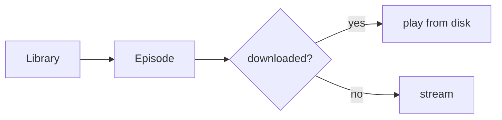

# Writing a PR title and body

Reviewers skim. Put the shape of the change on the first screen, then let
diagrams, code, and screenshots carry the detail.

## Title

- Conventional Commits: `fix(player): keep playback running when the app
  goes to the background`. PRs squash-merge with the number appended, so the
  title is the commit.
- Scope is the area of the app: a screen or feature (`player`, `library`,
  `episode`), `e2e` for tests and config, `deps` for SDK or package bumps.
- Name the outcome, not the activity. "show downloaded episodes offline", not
  "library changes".

## Body

Do not write essays. A few bullets on what changed and why, then evidence.

- Bullet points for the prose you do write. One fact per bullet.
- A mermaid diagram for anything with flow or state: navigation between
  screens, playback state, data loading, before/after architecture.
- Code samples: a new component or hook API, a new route, or the key
  internal snippet. Fenced blocks with a language tag.
- Code refs (`src/app/(tabs)/index.tsx:42`, GitHub permalinks) instead of
  paraphrasing code.
- UI changes: a before/after table with screenshots or screen recordings.
  Show both iOS and Android when the change touches both.
- Native changes (new library with native code, `app.json` or config plugin
  edits, Expo SDK bump): say so in one bullet, since they need a new
  development build and cannot ship as an `eas update`.
- A `## Issue` section with `Fixes #123` or the Linear issue ID when the PR
  resolves one.
- A `## Verified` section, required on every PR:
  - First line: `Ran it locally: yes`, or `Ran it locally: no - <why>`
    (docs typo, CI-only, a device you do not have).
  - With `yes`: the platform and device (`iOS, iPhone 17 Pro simulator`),
    the command you ran (`npx e2e run tests/podcasts.e2e.ts`), what you saw,
    and screenshots or video showing it work. The e2e MCP server can take
    screenshots and record video of the running app.
  - A `fix` PR with `yes` also shows the bug and the fix side by side in a
    `| main | this branch |` table.
  - Upload media with `gh` 2.99+ `--attach`: reference images in the body as
    markdown (``) and pass each file as `--attach`; `gh`
    uploads them and rewrites those paths. Do not write video paths in the
    body: attached videos are appended at the end and render as players.

## Leave out

- "I ran lint/typecheck/tests" lists. CI reports that; `## Verified` is for
  what CI cannot see.
- Intermediate history. Rewrote the screen twice, renamed midway, reverted a
  library: none of it lands. Only the final squash-merge commit exists, so
  only that gets commentary.
- Line-by-line restating of the diff.
- Checklists nobody asked for, sign-offs, filler.

## Templates

Before/after for visuals:

```markdown
| Before | After |
| --- | --- |
|  |  |
```

Both platforms:

```markdown
| | iOS | Android |
| --- | --- | --- |
| Before |  |  |
| After |  |  |
```

Verified, for a fix (local image paths become uploaded assets with `--attach`):

```markdown
## Verified

Ran it locally: yes
- iOS, iPhone 17 Pro simulator, `npx e2e run tests/podcasts.e2e.ts`: the new
  test fails on main and passes here

| main | this branch |
| --- | --- |
|  |  |
```

`gh pr edit <pr> --body-file body.md --attach ./main.png --attach ./branch.png --attach ./video.mp4`

Flow:

````markdown

````

## Big changes

For truly impressive, difficult, high-risk, or wide-scoped changes, write the
body like a technical blog post: context, the problem, the approach, code
samples, diagrams, before/after, images. Storytelling is fine here. The rules
above still hold: run output only as `## Verified` evidence, no
intermediate history.

## Voice

Reread the final text before posting and cut AI tells:

- "This PR introduces...", "comprehensive", "robust", "seamless", "ensures",
  "leverages", "enhances".
- Bold label lists that restate the line (`**Performance:** Performance...`).
- Em dashes. Use a comma, a colon, or a new sentence.
- Bullets padded to three because three felt right.
- A summary that could be pasted unchanged into another repo's PR.
