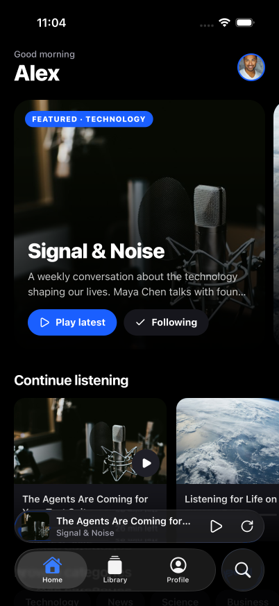
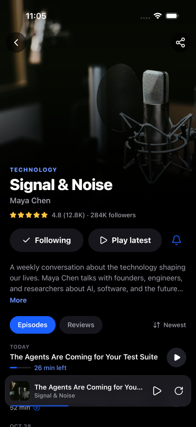
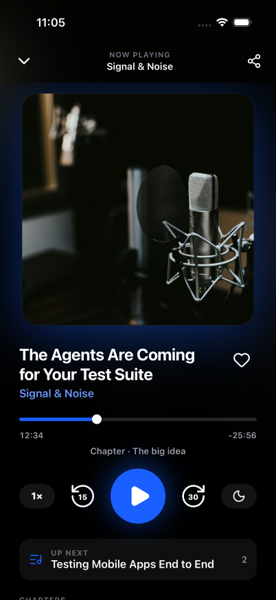
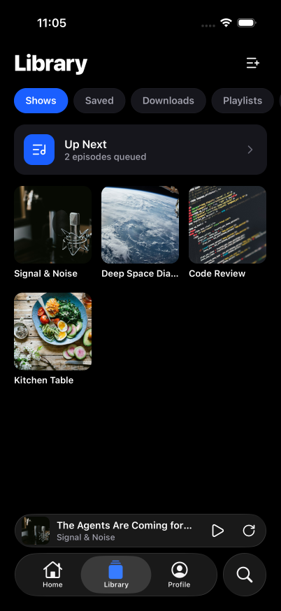
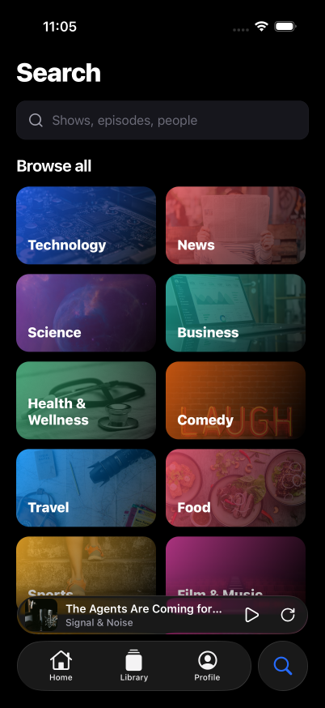

# e2e React Native example

A mock podcast app built with [Expo](https://expo.dev) and tested end to end with [e2e](https://www.npmjs.com/package/e2e), the agentic test runner. The same test suite runs on iOS, Android, and the web.

The app is a fake podcast player with a Home, Search, Library, and Profile tab, show and episode pages, a player with a queue and sleep timer, playlists, sharing, and settings. All data is local and mocked in `src/data/podcasts.ts`.

<p align="center">
  
  
  
  
  
</p>

## Get started

1. Install dependencies

   ```bash
   npm install
   ```

2. Build and run the app on a simulator, emulator, or in the browser

   ```bash
   npm run ios       # npx expo run:ios
   npm run android   # npx expo run:android
   npm run web       # npx expo start --web
   ```

The `ios/` and `android/` directories are generated by [Continuous Native Generation](https://docs.expo.dev/workflow/continuous-native-generation/). Don't edit them by hand; configure native behavior in `app.json` instead.

## Project structure

```
src/
  app/          Expo Router screens (tabs, show, episode, player, playlists, ...)
  components/   Shared UI (mini player, scrubber, toast, ...)
  data/         Mocked podcasts, episodes, and categories
  store/        Library and player state
tests/          e2e tests, one file per feature
e2e.config.ts   e2e targets and agent setup
```

## End-to-end tests

Tests live in `tests/*.e2e.ts`. Each test mixes `agent.act` goals written in plain language with exact locator assertions:

```ts
test('save an episode', async ({ agent, screen }) => {
  await agent.act('save the episode');

  await expect(screen.getByRole('button', 'Saved')).toBeSelected();
});
```

### Setup

The agent runs on a model served by the [Vercel AI Gateway](https://vercel.com/docs/ai-gateway). Set `AI_GATEWAY_API_KEY`, or link a Vercel project to use its OIDC token.

The iOS and Android targets need a development build installed first (`npm run ios` / `npm run android`). The iOS target runs on an iPhone 17 Pro simulator.

### Running

```bash
npm run test:e2e:ios       # iOS simulator
npm run test:e2e:android   # Android emulator
npm run test:e2e:web       # browser, phone-sized viewport
```

Run a single file with `npx e2e run tests/episode.e2e.ts --target ios`.

All three targets share one Metro server on port 8081, which e2e starts if it isn't already running. Its log goes to `.e2e/logs/metro.log`. Agent steps are cached in `.e2e/cache` so repeat runs replay without calling the model.

### Writing tests

Structure every test as Arrange, Act, Assert, and check one outcome per test. See [AGENTS.md](AGENTS.md#e2e-tests) for the full conventions.

## Learn more

- [e2e documentation](https://www.npmjs.com/package/e2e)
- [Expo documentation](https://docs.expo.dev/)
- [Expo Router](https://docs.expo.dev/router/introduction/)
